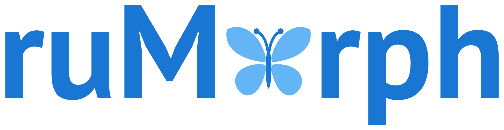
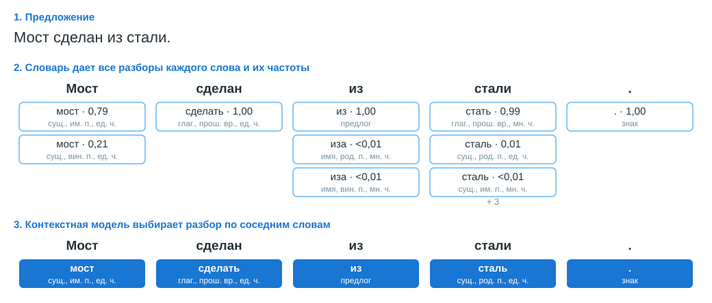

# ruMorph



**ruMorph** - морфологический анализатор русского языка: ядро на Rust и API для Python. Для словоформы анализатор находит по словарю OpenCorpora и словам Викисловаря варианты разбора - начальную форму (лемму), часть речи и признаки [Universal Dependencies](https://universaldependencies.org/) - упорядочивает их по вероятности и строит формы слова.

!!! note "Ранняя версия"
    До 1.0 API может меняться между версиями 0.x, изменения описываются в заметках к выпускам.

## Как это работает

Каждое слово анализатор находит в словаре - там все его разборы и их частоты. В предложении разбор выбирает контекстная модель по соседним словам: «стали» в словаре прежде всего глагол «стать», а в «Мост сделан из стали» - существительное «сталь» в родительном падеже. Устройство моделей - на странице [Модели](models.md).



## Возможности

<div class="grid cards" markdown>

-   :material-magnify:{ .lg .middle } __Разбор__

    ---

    Лемма, часть речи и признаки UD, вероятность разбора; разбор предложения с учетом контекста; списки слов и лемматизация без GIL

    [:octicons-arrow-right-24: Анализатор](analyzer.md)

-   :material-tag-text-outline:{ .lg .middle } __Universal Dependencies__

    ---

    Части речи, признаки и леммы по руководству UD и соглашениям SynTagRus; числа, знаки и латиница по правилам, незнакомые слова - по окончанию и модели, обученной на словаре

    [:octicons-arrow-right-24: Разбор словоформы](analysis.md)

-   :material-format-letter-case:{ .lg .middle } __Словоизменение__

    ---

    Формы лексемы, форма по признакам UD, согласование с количеством

    [:octicons-arrow-right-24: Словоизменение](inflection.md)

-   :material-console:{ .lg .middle } __Команда rumorph__

    ---

    Разбор файлов и потоков из командной строки: леммы, CoNLL-U, TSV, JSON Lines и текст с «ё»

    [:octicons-arrow-right-24: Команда rumorph](cli.md)

-   :material-graph-outline:{ .lg .middle } __Модели__

    ---

    Контекстная модель, которая выбирает разбор по соседним словам, и модель разборов незнакомых слов: устройство, вероятности, обучение

    [:octicons-arrow-right-24: Модели](models.md)

-   :material-swap-horizontal:{ .lg .middle } __Переход с pymorphy__

    ---

    Соответствие вызовов pymorphy2 и pymorphy3, частей речи и граммем

    [:octicons-arrow-right-24: Переход с pymorphy](migration.md)

-   :material-speedometer:{ .lg .middle } __Сравнение__

    ---

    Точность и скорость в сравнении с pymorphy3, mystem, spaCy, Stanza и Slovnet, загрузка словаря и память

    [:octicons-arrow-right-24: Сравнение](performance.md)

-   :material-alert-circle-outline:{ .lg .middle } __Исключения__

    ---

    Встроенные исключения Python и `FormNotFoundError` для отсутствующих форм

    [:octicons-arrow-right-24: Исключения](exceptions.md)

</div>

## Установка

Требуется Python 3.11 или новее.

``` bash
pip install rumorph
```

Готовые колеса и сборка из исходников описаны на странице [Установка](installation.md).

## Быстрый старт

=== "Код"

    ``` python
    from rumorph import Analyzer

    morph = Analyzer()
    morph.lemmatize(["Мы", "стали", "друзьями"])
    [(a.lemma, a.pos, a.feats.get("Case"), round(a.prob, 3)) for a in morph.analyze("стали")][:2]
    cat = morph.analyze("кошка")[0]
    cat.inflect(Case="Gen", Number="Plur"), morph.analyze("рубль")[0].agree(5)
    ```

=== "Результат"

    ```
    ['мы', 'стать', 'друг']
    [('стать', 'VERB', None, 0.988), ('сталь', 'NOUN', 'Gen', 0.005)]
    ('кошек', 'рублей')
    ```

??? note "Структура проекта"

    *   **crates/rumorph** - ядро анализатора на Rust: формат словаря, сборка, разбор, контекстная модель и словоизменение
    *   **crates/rumorph-build** - сборка словаря из выгрузки OpenCorpora и Викисловаря, перевод тегов OpenCorpora в UD и частоты разборов по трибанкам UD
    *   **crates/rumorph-dict-ru** - крейт со словарем для `rumorph` на crates.io
    *   **crates/rumorph-py** - модуль Python `rumorph._rumorph` на PyO3
    *   **python/rumorph** - пакет Python
    *   **scripts** - выгрузка словаря и корпуса OpenCorpora, перевод слов Викисловаря, выгрузка счетчиков трибанков UD, обучение контекстной модели, проверка установленного пакета перед публикацией и сравнение с другими анализаторами
    *   **data** - веса контекстной модели, которые сборщик вшивает в словарь
    *   **docs** - документация MkDocs на русском и английском
    *   **tests** - тесты пакета Python
