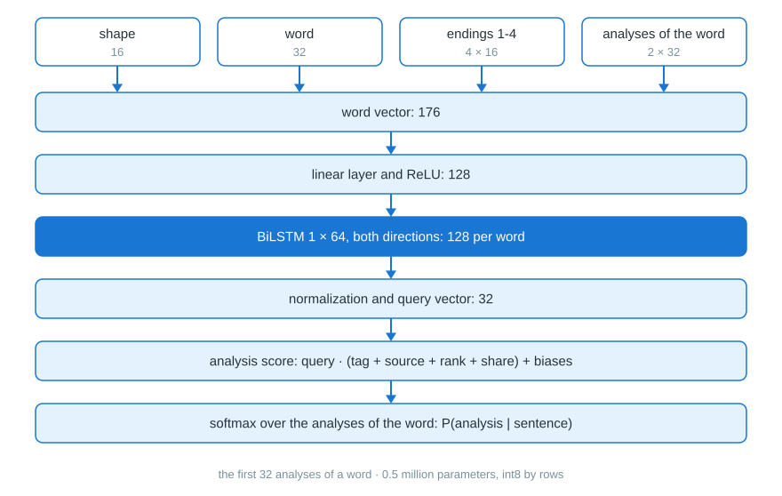
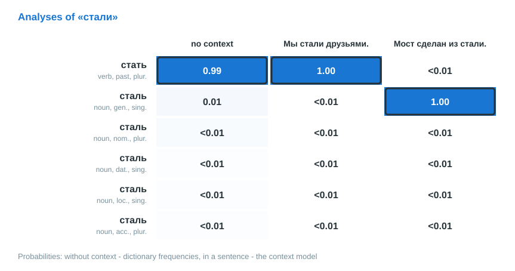
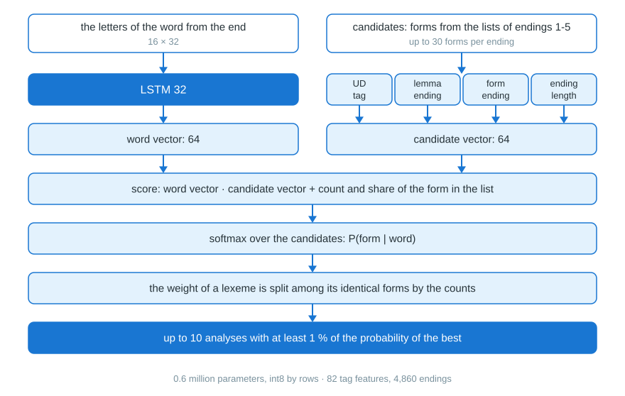
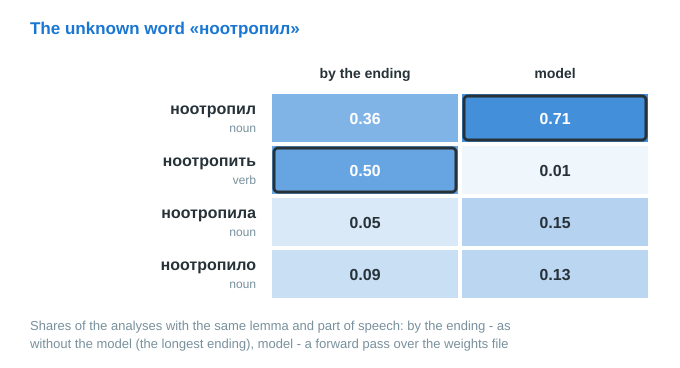

# Models

The dictionary holds two small models: the context model chooses the analysis of a word by the neighbouring words of the sentence, the paradigm class model chooses the analyses of an unknown word. Both are sections of the dictionary file: no separate weight files are needed, and each is read on first use.

## Context model { #context }

It works in [`analyze_sentence`](analyzer.md#analyze_sentence), [`annotate`](analyzer.md#annotate) and the [rumorph command](cli.md): it orders the same analyses the dictionary gives by the neighbouring words, and the analysis chosen in context comes first.

- **Word input** - the shape (lowercase or uppercase letters, a capital, digits, Latin script, the start of the sentence or of a verse line, a hyphen), the word itself (the 8 thousand most frequent words of the training data; lowercase, «ё» as «е»; the others are unknown), the endings of 1 to 4 letters and the dictionary analyses - the mean and the probability-weighted vector of their tags.
- **Encoder** - a bidirectional LSTM, one layer of 64 per direction: every word sees the whole sentence.
- **Analysis score** - the dot product of the query vector of the word and the vector of the analysis: its UD tag (the part of speech, every feature and their combination), its source (the dictionary, a rule or a guess), its place among the analyses of the word and its share in the dictionary; the scores of the analyses of a word become probabilities. The model sees the first 32 analyses of a word, the rest follow them with probability 0.
- **Weights** - 0.5 million parameters, int8 matrices by rows with a factor per row.

### Choosing an analysis { #choice }

Without context the analyses follow the dictionary frequencies: «стали» is first of all the verb «стать» (0.99). In the sentence «Мы стали друзьями» the model keeps the verb, and in «Мост сделан из стали» it chooses the noun «сталь» in the genitive - the preposition «из» and the verb «сделан» outweigh the frequency. The numbers in the picture are a forward pass of the package model (`scripts/figures.py`), checked against the analysis of the core.

### Training { #training }

The model is trained on the training parts of the [UD_Russian-Taiga](https://github.com/UniversalDependencies/UD_Russian-Taiga), [UD_Russian-GSD](https://github.com/UniversalDependencies/UD_Russian-GSD) and [UD_Russian-Poetry](https://github.com/UniversalDependencies/UD_Russian-Poetry) (poetry of the 19th-21st centuries: literary word order) treebanks of the UD 2.19 release and on the [OpenCorpora](https://opencorpora.org/) corpus: for every word, choose the dictionary analysis that matches the annotation. [UD_Russian-SynTagRus](https://github.com/UniversalDependencies/UD_Russian-SynTagRus) is distributed under CC BY-NC-SA 4.0 and is not part of the training: the model is only evaluated on it. `scripts/train_context.py` reproduces the training; the model learns on the dictionary analyses, so after the UD tags of the dictionary change it has to be retrained - the builder does not embed old weights.

## Paradigm class model { #paradigms }

The analyses of an unknown word come from the dictionary by its ending: the forms of dictionary words with the same ending give the part of speech, the features and the inflection. For a lowercase word the model chooses among these forms:

- **Candidates** - the forms from the lists of all endings of the word of 1 to 5 letters, up to 30 most frequent forms per ending.
- **Word input** - the last 16 letters: an LSTM of size 32 reads them from the end.
- **Candidate score** - the dot product of the word vector and the candidate vector: the UD tag, the endings of the form and of the initial form, the length of the ending and the frequency of the form in the list.

The model is trained on the dictionary itself: for 1.2 million of its words it chooses among the candidates as if the word were not in the dictionary - `scripts/train_paradigms.py`. On the forms of lexemes missing from the dictionary the lemma and part of speech of the first analysis are right for 89.4 % of the forms against 86.1 % for the choice by the frequency of the ending. A capitalized word - usually a name - is guessed by the frequency of the ending: on names the model made more mistakes.

By its longest ending «-ропил» the word «ноотропил» looks first of all like a verb in the past tense: by the frequency of the ending half of the weight goes to the verb «ноотропить». The model reads the whole word and chooses the noun «ноотропил» (0.72), and the verb does not get into the analyses. The numbers of the model are the probabilities of `analyze`; `scripts/figures.py` checks them against a forward pass of the model over the weights file.

## License { #license }

The weights are trained on data under CC BY-SA licenses and are distributed as part of the dictionary under CC BY-SA 4.0 ([LICENSE-DICTIONARY.txt](https://github.com/SergeyShk/ruMorph/blob/master/LICENSE-DICTIONARY.txt)); the ruMorph code is under the MIT license.
