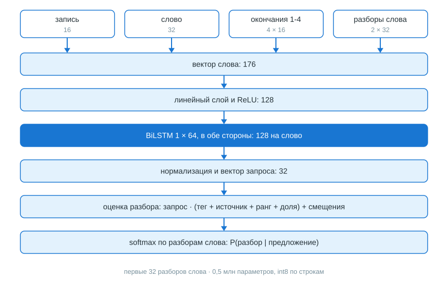
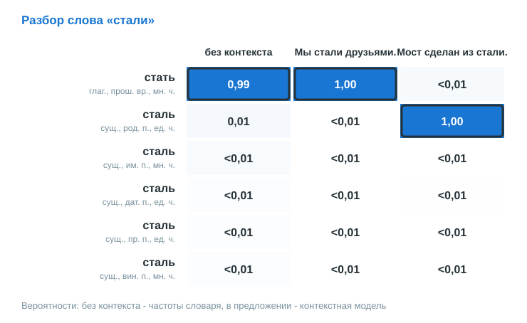
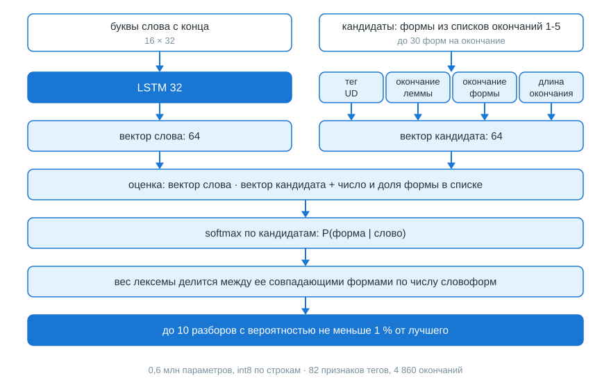
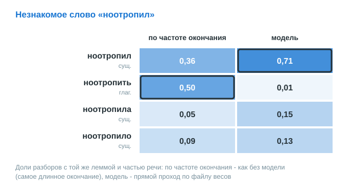

# Модели

В словаре две небольшие модели: контекстная выбирает разбор слова по соседним словам в предложении, модель класса парадигмы - разборы незнакомого слова. Обе - секции файла словаря: отдельных файлов весов не нужно, а читается каждая при первом использовании.

## Контекстная модель { #context }

Работает в [`analyze_sentence`](analyzer.md#analyze_sentence), [`annotate`](analyzer.md#annotate) и в [команде rumorph](cli.md): упорядочивает те же разборы, что дает словарь, по соседним словам, и первым идет разбор, выбранный в контексте.

- **Вход слова** - запись (буквы в нижнем или верхнем регистре, с заглавной, цифры, латиница, начало предложения или строки стиха, дефис), само слово (8 тыс. самых частых слов обучающих данных; строчные буквы, «ё» как «е»; остальные - неизвестные), окончания длиной от 1 до 4 букв и разборы словаря - средний и взвешенный по вероятностям вектор их тегов.
- **Кодировщик** - двунаправленный LSTM, один слой по 64 на направление: каждое слово видит все предложение.
- **Оценка разбора** - скалярное произведение вектора запроса слова с вектором разбора: его тег UD (часть речи, каждый признак и их сочетание), источник (словарь, правило или угадывание), место среди разборов слова и доля в словаре; оценки разборов слова переводятся в вероятности. Модель видит первые 32 разбора слова, остальные идут после них с вероятностью 0.
- **Веса** - 0,5 млн параметров, матрицы в int8 по строкам с множителем на строку.

### Выбор разбора { #choice }

Без контекста порядок разборов - частоты словаря: «стали» - прежде всего глагол «стать» (0,99). В предложении «Мы стали друзьями» модель оставляет глагол, а в «Мост сделан из стали» выбирает существительное «сталь» в родительном падеже - предлог «из» и глагол «сделан» перевешивают частоту. Числа на картинке - прямой проход модели пакета (`scripts/figures.py`), сверенный с разбором ядра.

### Обучение { #training }

Модель обучена на обучающих частях трибанков [UD_Russian-Taiga](https://github.com/UniversalDependencies/UD_Russian-Taiga), [UD_Russian-GSD](https://github.com/UniversalDependencies/UD_Russian-GSD) и [UD_Russian-Poetry](https://github.com/UniversalDependencies/UD_Russian-Poetry) (поэзия XIX-XXI веков: литературный порядок слов) релиза UD 2.19 и на корпусе [OpenCorpora](https://opencorpora.org/): для каждого слова - выбрать из разборов словаря тот, что совпадает с разметкой. [UD_Russian-SynTagRus](https://github.com/UniversalDependencies/UD_Russian-SynTagRus) распространяется по лицензии CC BY-NC-SA 4.0 и в обучение не входит: на нем модель только проверяется. Обучение воспроизводит `scripts/train_context.py`; модель учится на разборах словаря, поэтому после смены тегов UD словаря ее нужно переобучить - сборщик не вшивает старые веса.

## Модель класса парадигмы { #paradigms }

Разборы незнакомого слова берутся из словаря по окончанию: формы словарных слов с тем же окончанием дают часть речи, признаки и словоизменение. У строчного слова из этих форм выбирает модель:

- **Кандидаты** - формы из списков всех окончаний слова длиной от 1 до 5 букв, до 30 самых частых форм на окончание.
- **Вход слова** - последние 16 букв: их читает с конца LSTM размером 32.
- **Оценка кандидата** - скалярное произведение вектора слова с вектором кандидата: тег UD, окончание формы и начальной формы, длина окончания и частота формы в списке.

Модель обучена на самом словаре: для 1,2 млн его слов она выбирает среди кандидатов так, как если бы слова в словаре не было, - `scripts/train_paradigms.py`. На формах лексем, которых нет в словаре, лемма и часть речи первого разбора верны у 89,4 % форм против 86,1 % у выбора по частоте окончания. Слово с заглавной буквы - обычно имя - угадывается по частоте окончания: на именах модель ошибалась чаще.

По самому длинному окончанию «-ропил» слово «ноотропил» похоже прежде всего на глагол в прошедшем времени: по частоте окончания половина веса - у глагола «ноотропить». Модель читает все слово и выбирает существительное «ноотропил» (0,72), а глагол в разборы не попадает. Числа модели - вероятности `analyze`, `scripts/figures.py` сверяет их с прямым проходом модели по файлу весов.

## Лицензия { #license }

Веса обучены на данных под лицензиями CC BY-SA и распространяются в составе словаря под лицензией CC BY-SA 4.0 ([LICENSE-DICTIONARY.txt](https://github.com/SergeyShk/ruMorph/blob/master/LICENSE-DICTIONARY.txt)); код ruMorph - под лицензией MIT.
