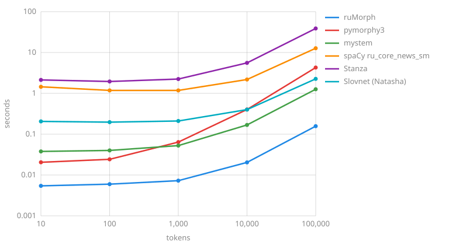

# Comparison

Without context ruMorph analyzes a word like pymorphy3 and mystem, and it is the most accurate of them: on three UD test sets the first analysis gets both the part of speech and the lemma right for 91-94 % of words against 79-85 % for pymorphy3 and mystem. It is also the fastest: 693 thousand tokens per second, 30 times faster than pymorphy3 and 8 times faster than mystem, and it answers a short text together with loading in 6 ms. With context ([`analyze_sentence`](analyzer.md#analyze_sentence)) ruMorph is more accurate than all the taggers in the part of speech, lemma and features together on Taiga and GSD, and on SynTagRus it is behind only Stanza, by 0.2 points, although Stanza is trained on SynTagRus and ruMorph has never seen it. Meanwhile it analyzes 108 thousand tokens per second, 39 times faster than Stanza.

## Quality { #quality }

The gold standard is the test parts of the [UD_Russian-SynTagRus](https://github.com/UniversalDependencies/UD_Russian-SynTagRus), [UD_Russian-Taiga](https://github.com/UniversalDependencies/UD_Russian-Taiga) and [UD_Russian-GSD](https://github.com/UniversalDependencies/UD_Russian-GSD) treebanks from the UD 2.18 release: every system gets their tokens, punctuation is not counted, and lemmas are compared ignoring case and with «е» instead of «ё». The treebanks follow different annotation conventions, so systems should be compared on the same set rather than sets against each other.

### Without context { #context-free }

The share of words whose first analysis has the right part of speech and lemma, in brackets - at least one of the analyses, %:

| System | SynTagRus | Taiga | GSD |
| :----- | :-------- | :---- | :-- |
| ruMorph | **93.9** (98.5) | **90.6** (95.7) | **91.8** (95.6) |
| pymorphy3 | 84.8 (90.6) | 82.9 (88.9) | 84.3 (87.9) |
| mystem | 81.9 (86.4) | 79.4 (83.8) | 79.9 (83.9) |

pymorphy3 and mystem annotate by their own rules, and their parts of speech are converted to UD by a simple table: a noun is `NOUN`, or `PROPN` with a grammeme of a name, a surname or a place, a pronoun-noun is `PRON`, a pronominal adjective is `DET` and so on. So some of their errors are differences of conventions rather than of analysis: «быть» is a verb for them but `AUX` in UD, and they do not split conjunctions into coordinating and subordinating (the conjunction «что» is `SCONJ` in UD). ruMorph follows the UD conventions. mystem does not analyze numbers written in digits.

### With context { #contextual }

Taggers see the sentence and choose one analysis; ruMorph here is the analysis in context (`analyze_sentence`), the first analysis without context is in the «All metrics» table. The share of words with the right part of speech, lemma and UD features (case, number, gender, person, tense, aspect, mood, voice, verb form, degree, animacy), %:

=== "SynTagRus"

    | System | Part of speech | Lemma | Features |
    | :----- | :------------- | :---- | :------- |
    | ruMorph in context | 97.2 | **98.0** | 95.0 |
    | Stanza | **98.0** | 97.8 | **95.3** |
    | spaCy ru_core_news_sm | 94.1 | 90.7 | 81.0 |
    | Slovnet (Natasha) | 93.7 | - | 86.8 |

=== "Taiga"

    | System | Part of speech | Lemma | Features |
    | :----- | :------------- | :---- | :------- |
    | ruMorph in context | **94.8** | **96.8** | **93.3** |
    | Stanza | 94.5 | 94.9 | 90.3 |
    | spaCy ru_core_news_sm | 89.8 | 87.9 | 74.9 |
    | Slovnet (Natasha) | 88.2 | - | 81.1 |

=== "GSD"

    | System | Part of speech | Lemma | Features |
    | :----- | :------------- | :---- | :------- |
    | ruMorph in context | 95.3 | **97.4** | 83.1 |
    | Stanza | **96.0** | 95.9 | **83.7** |
    | spaCy ru_core_news_sm | 94.0 | 92.0 | 77.5 |
    | Slovnet (Natasha) | 93.5 | - | 79.8 |

The default Stanza model is trained on SynTagRus, so its test part is Stanza's own; the ruMorph context model is trained on the training parts of Taiga and GSD, and SynTagRus is new to it; spaCy ru_core_news_sm and Slovnet are trained on Nerus, news annotated automatically. Slovnet gives no lemmas: in Natasha they come from pymorphy2.

??? note "All metrics"

    The case and number of pymorphy3 and mystem are converted to UD by the same table; all features and "all together" (part of speech, lemma and features) only for systems with UD features.

    === "SynTagRus"

        | System | Lemma | Part of speech | Case | Number | Features | All together |
        | :----- | :---- | :------------- | :--- | :----- | :------- | :----------- |
        | ruMorph | 96.8 | 95.2 | 88.1 | 96.4 | 84.0 | 82.2 |
        | ruMorph in context | 98.0 | 97.2 | 97.6 | 98.8 | 95.0 | 93.3 |
        | pymorphy3 | 94.1 | 87.0 | 87.0 | 94.8 | - | - |
        | mystem | 90.9 | 88.2 | 76.9 | 92.7 | - | - |
        | spaCy ru_core_news_sm | 90.7 | 94.1 | 95.6 | 97.3 | 81.0 | 76.5 |
        | Stanza | 97.8 | 98.0 | 98.4 | 99.2 | 95.3 | 93.5 |
        | Slovnet (Natasha) | - | 93.7 | 95.0 | 96.7 | 86.8 | - |

    === "Taiga"

        | System | Lemma | Part of speech | Case | Number | Features | All together |
        | :----- | :---- | :------------- | :--- | :----- | :------- | :----------- |
        | ruMorph | 95.6 | 92.2 | 87.0 | 95.6 | 82.1 | 78.0 |
        | ruMorph in context | 96.8 | 94.8 | 96.8 | 97.9 | 93.3 | 90.0 |
        | pymorphy3 | 92.7 | 85.3 | 85.7 | 93.8 | - | - |
        | mystem | 90.5 | 85.2 | 77.0 | 91.7 | - | - |
        | spaCy ru_core_news_sm | 87.9 | 89.8 | 91.7 | 94.0 | 74.9 | 68.8 |
        | Stanza | 94.9 | 94.5 | 96.3 | 97.1 | 90.3 | 85.6 |
        | Slovnet (Natasha) | - | 88.2 | 90.6 | 93.0 | 81.1 | - |

    === "GSD"

        | System | Lemma | Part of speech | Case | Number | Features | All together |
        | :----- | :---- | :------------- | :--- | :----- | :------- | :----------- |
        | ruMorph | 96.2 | 93.6 | 80.8 | 93.1 | 72.8 | 71.1 |
        | ruMorph in context | 97.4 | 95.3 | 90.1 | 94.8 | 83.1 | 81.3 |
        | pymorphy3 | 94.5 | 86.1 | 79.7 | 92.3 | - | - |
        | mystem | 91.2 | 85.5 | 66.3 | 88.1 | - | - |
        | spaCy ru_core_news_sm | 92.0 | 94.0 | 89.5 | 94.7 | 77.5 | 72.0 |
        | Stanza | 95.9 | 96.0 | 91.3 | 95.4 | 83.7 | 80.3 |
        | Slovnet (Natasha) | - | 93.5 | 89.0 | 94.3 | 79.8 | - |

## Speed { #speed }

### Text analysis { #text }

The time to analyze a text together with importing and loading the system in a new process, seconds, both axes on a logarithmic scale:

On a short text almost all the time goes to loading: ruMorph answers in 6 ms, in context in 14 ms, pymorphy3 and mystem in 20-40 ms, Slovnet in 0.2 s, spaCy in 1.1-1.3 s, Stanza in 2 s. On a long text the analysis speed decides, tokens per second without loading, more is better:

| System | Tokens per second |
| :----- | :---------------- |
| ruMorph | **693,383** |
| ruMorph in context | 107,565 |
| mystem | 82,191 |
| Slovnet (Natasha) | 45,286 |
| pymorphy3 | 23,484 |
| spaCy ru_core_news_sm | 8,627 |
| Stanza | 2,738 |

### Operations { #operations }

Thousands of words or analyses per second compared with pymorphy3, more is better:

| Operation | ruMorph | pymorphy3 | pymorphy3[fast] |
| :-------- | :------ | :-------- | :-------------- |
| Analysis of a word form: `analyze` in a loop, `parse` | 675 | 20 | 104 |
| Analysis of a list: `analyze_many` | 701 | - | - |
| Lemmatization: `lemmatize`, `parse(word)[0].normal_form` | 1,340 | 22 | 169 |
| Lemmatization in 4 threads: `lemmatize` | 4,148 | - | - |
| Form by features: `inflect(Case="Gen")`, `inflect({"gent"})` | 1,407 | 76 | 76 |
| Agreement with a number: `agree(5)`, `make_agree_with_number(5)` | 1,352 | 85 | 84 |
| Forms of the lexeme: `forms()`, `lexeme` | 75 | 31 | 32 |

Lists of words are processed without the GIL, so several threads sharing one analyzer run in parallel.

## Loading and memory { #memory }

| | ruMorph | pymorphy3 | pymorphy3[fast] |
| :- | :------ | :-------- | :-------------- |
| Import and dictionary loading | 5 ms | 31 ms | 33 ms |
| Growth of process memory | 16.5 MB | 34.5 MB | 25.5 MB |
| Every further process | 1.2 MB | 32.5 MB | 23.1 MB |

The context model is read at the first sentence analysis: 9 ms and 5 MB of memory. Analyzers with the same dictionary file in a process share the dictionary and the model. The dictionary file is mapped into memory, so `multiprocessing` or joblib processes and web server workers share it too: every further process adds only the analyzer's own tables.

## How it was measured { #method }

- Quality and text analysis - the [`scripts/compare.py`](https://github.com/SergeyShk/ruMorph/blob/master/scripts/compare.py) script: `uv run --with rumorph==X.Y.Z scripts/compare.py build/compare --chart docs/img/speed.svg`, where `X.Y.Z` is the ruMorph version (without `--with`, the version from `scripts/compare.py.lock`; a path to a wheel works instead of the version). It installs the systems into a separate environment with the versions of all packages pinned in `scripts/compare.py.lock`, downloads the treebank test parts, the models and mystem with checksum verification before measuring and analyzes the gold tokens. The tables converting the parts of speech, case and number of pymorphy3 and mystem to UD are at the top of the script.
- Versions: Python 3.11, ruMorph 0.4.0.dev3 (text analysis speed - 0.4.0.dev2: the analysis has not changed since), pymorphy3 2.0.6 with the pymorphy3-dicts-ru 2.4.417150.4580142 dictionary, mystem 3.1 through pymystem3 0.2.0 without disambiguation (for quality, each word separately; the macOS binary is built for x86_64 and runs through Rosetta 2), spaCy 3.8.16 with the ru_core_news_sm 3.8.0 model, Stanza 1.15.0 with the default model on the CPU (torch 2.14.1), Slovnet 0.6.0 with the slovnet_morph_news_v1 and navec_news_v1 models. Computer - Apple M3 Pro, macOS 26.
- Text analysis speed - 157,706 tokens of the SynTagRus test part with punctuation in one thread: tokens per second - the best of two analyses of the whole part after loading, chart points - importing, loading and analyzing the first 10-100,000 tokens in a new process. Only the call of the system is measured: mystem gets a whole sentence, spaCy analyzes sentences with `nlp.pipe`, ruMorph in context - `analyze_sentence` per sentence.
- Operations and memory - ruMorph 0.3.0, pymorphy3 2.0.6, `pymorphy3[fast]` - the same with the C++ DAWG extension; 128,251 word forms of the SynTagRus test part without punctuation, the best of three runs in one thread, except for the row with threads. `inflect` - the genitive of the first analyses that have a case, `agree` - the first analyses of nouns with the number 5, `forms` - the first analyses of the first 20,000 words. Memory - the growth of the resident memory of the process (`ps -o rss`) after importing and creating the analyzer, time - the import, creating the analyzer and the first analysis; a further process - the growth of the memory the process does not share with others (USS), in each of four `multiprocessing` processes.
