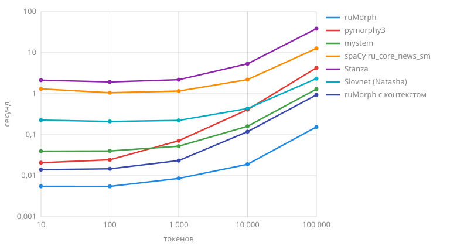

# Сравнение

Без контекста ruMorph разбирает слово, как pymorphy3 и mystem, и среди них он самый точный: на трех тестовых наборах UD у первого разбора верны часть речи и лемма у 91-94 % слов против 79-85 % у pymorphy3 и mystem. И самый быстрый: 693 тыс. токенов в секунду, в 30 раз быстрее pymorphy3 и в 8 раз быстрее mystem, а на короткий текст вместе с загрузкой отвечает за 6 мс. С контекстом ([`analyze_sentence`](analyzer.md#analyze_sentence)) ruMorph по части речи, лемме и признакам вместе точнее всех теггеров на Taiga и GSD, а на SynTagRus уступает только Stanza - 0,3 пункта, хотя Stanza обучена на SynTagRus, а ruMorph его не видел. При этом он разбирает 108 тыс. токенов в секунду - в 39 раз быстрее Stanza.

## Качество { #quality }

Эталон - тестовые части трибанков [UD_Russian-SynTagRus](https://github.com/UniversalDependencies/UD_Russian-SynTagRus), [UD_Russian-Taiga](https://github.com/UniversalDependencies/UD_Russian-Taiga) и [UD_Russian-GSD](https://github.com/UniversalDependencies/UD_Russian-GSD) из релиза UD 2.18: каждая система получает их токены, знаки препинания не считаются, леммы сравниваются без учета регистра и с «е» вместо «ё». Соглашения разметки у трибанков разные, поэтому сравнивать стоит системы на одном наборе, а не наборы между собой.

### Без контекста { #context-free }

Доля слов, у которых верны часть речи и лемма первого разбора, в скобках - хотя бы одного из разборов, %:

| Система | SynTagRus | Taiga | GSD |
| :------ | :-------- | :---- | :-- |
| ruMorph | **93,8** (98,2) | **90,6** (95,6) | **91,9** (95,6) |
| pymorphy3 | 84,8 (90,6) | 82,9 (88,9) | 84,3 (87,9) |
| mystem | 81,9 (86,4) | 79,4 (83,8) | 79,9 (83,9) |

pymorphy3 и mystem размечают по своим правилам, их части речи переведены в UD простой таблицей: существительное - `NOUN`, а с граммемой имени, фамилии или топонима - `PROPN`, местоимение-существительное - `PRON`, местоименное прилагательное - `DET` и т. д. Поэтому часть их ошибок - расхождения соглашений, а не разбора: «быть» у них глагол, а в UD - `AUX`, а союзы они не делят на сочинительные и подчинительные (союз «что» в UD - `SCONJ`). ruMorph следует соглашениям UD. mystem не разбирает числа цифрами.

### С контекстом { #contextual }

Теггеры видят предложение и выбирают один разбор; ruMorph здесь - разбор с контекстом (`analyze_sentence`), первый разбор без контекста - в таблице «Все метрики». Доля слов с верными частью речи, леммой и признаками UD (падеж, число, род, лицо, время, вид, наклонение, залог, форма глагола, степень, одушевленность), %:

=== "SynTagRus"

    | Система | Часть речи | Лемма | Признаки |
    | :------ | :--------- | :---- | :------- |
    | ruMorph с контекстом | 97,0 | **97,8** | 94,9 |
    | Stanza | **98,0** | **97,8** | **95,3** |
    | spaCy ru_core_news_sm | 94,1 | 90,7 | 81,0 |
    | Slovnet (Natasha) | 93,7 | - | 86,8 |

=== "Taiga"

    | Система | Часть речи | Лемма | Признаки |
    | :------ | :--------- | :---- | :------- |
    | ruMorph с контекстом | **94,7** | **96,6** | **93,1** |
    | Stanza | 94,5 | 94,9 | 90,3 |
    | spaCy ru_core_news_sm | 89,8 | 87,9 | 74,9 |
    | Slovnet (Natasha) | 88,2 | - | 81,1 |

=== "GSD"

    | Система | Часть речи | Лемма | Признаки |
    | :------ | :--------- | :---- | :------- |
    | ruMorph с контекстом | 95,1 | **97,4** | 83,0 |
    | Stanza | **96,0** | 95,9 | **83,7** |
    | spaCy ru_core_news_sm | 94,0 | 92,0 | 77,5 |
    | Slovnet (Natasha) | 93,5 | - | 79,8 |

Модель Stanza по умолчанию обучена на SynTagRus, и его тестовая часть для нее своя; контекстная модель ruMorph обучена на обучающих частях Taiga и GSD, а SynTagRus для нее чужой; spaCy ru_core_news_sm и Slovnet обучены на Nerus - новостях, размеченных автоматически. Slovnet не дает лемм: в Natasha их дает pymorphy2.

??? note "Все метрики"

    Падеж и число у pymorphy3 и mystem переведены в UD той же таблицей; признаки целиком и «все вместе» (часть речи, лемма и признаки) - только у систем с признаками UD.

    === "SynTagRus"

        | Система | Лемма | Часть речи | Падеж | Число | Признаки | Все вместе |
        | :------ | :---- | :--------- | :---- | :---- | :------- | :--------- |
        | ruMorph | 96,7 | 95,2 | 88,0 | 96,4 | 84,0 | 82,1 |
        | ruMorph с контекстом | 97,8 | 97,0 | 97,4 | 98,6 | 94,9 | 93,2 |
        | pymorphy3 | 94,1 | 87,0 | 87,0 | 94,8 | - | - |
        | mystem | 90,9 | 88,2 | 76,9 | 92,7 | - | - |
        | spaCy ru_core_news_sm | 90,7 | 94,1 | 95,6 | 97,3 | 81,0 | 76,5 |
        | Stanza | 97,8 | 98,0 | 98,4 | 99,2 | 95,3 | 93,5 |
        | Slovnet (Natasha) | - | 93,7 | 95,0 | 96,7 | 86,8 | - |

    === "Taiga"

        | Система | Лемма | Часть речи | Падеж | Число | Признаки | Все вместе |
        | :------ | :---- | :--------- | :---- | :---- | :------- | :--------- |
        | ruMorph | 95,6 | 92,2 | 86,8 | 95,5 | 81,7 | 77,7 |
        | ruMorph с контекстом | 96,6 | 94,7 | 96,6 | 97,9 | 93,1 | 89,7 |
        | pymorphy3 | 92,7 | 85,3 | 85,7 | 93,8 | - | - |
        | mystem | 90,5 | 85,2 | 77,0 | 91,7 | - | - |
        | spaCy ru_core_news_sm | 87,9 | 89,8 | 91,7 | 94,0 | 74,9 | 68,8 |
        | Stanza | 94,9 | 94,5 | 96,3 | 97,1 | 90,3 | 85,6 |
        | Slovnet (Natasha) | - | 88,2 | 90,6 | 93,0 | 81,1 | - |

    === "GSD"

        | Система | Лемма | Часть речи | Падеж | Число | Признаки | Все вместе |
        | :------ | :---- | :--------- | :---- | :---- | :------- | :--------- |
        | ruMorph | 96,3 | 93,6 | 80,8 | 93,1 | 72,8 | 71,2 |
        | ruMorph с контекстом | 97,4 | 95,1 | 90,0 | 94,7 | 83,0 | 81,2 |
        | pymorphy3 | 94,5 | 86,1 | 79,7 | 92,3 | - | - |
        | mystem | 91,2 | 85,5 | 66,3 | 88,1 | - | - |
        | spaCy ru_core_news_sm | 92,0 | 94,0 | 89,5 | 94,7 | 77,5 | 72,0 |
        | Stanza | 95,9 | 96,0 | 91,3 | 95,4 | 83,7 | 80,3 |
        | Slovnet (Natasha) | - | 93,5 | 89,0 | 94,3 | 79,8 | - |

## Скорость { #speed }

### Разбор текста { #text }

Время разбора текста вместе с импортом и загрузкой системы в новом процессе, секунд, по обеим осям - логарифмическая шкала:

На коротком тексте почти все время уходит на загрузку: ruMorph отвечает за 6 мс, с контекстом - за 14 мс, pymorphy3 и mystem - за 20-40 мс, Slovnet - за 0,2 с, spaCy - за 1,1-1,3 с, Stanza - за 2 с. На длинном решает скорость разбора, токенов в секунду без загрузки, больше - лучше:

| Система | Токенов в секунду |
| :------ | :---------------- |
| ruMorph | **693 383** |
| ruMorph с контекстом | 107 565 |
| mystem | 82 191 |
| Slovnet (Natasha) | 45 286 |
| pymorphy3 | 23 484 |
| spaCy ru_core_news_sm | 8 627 |
| Stanza | 2 738 |

### Операции { #operations }

Тысяч слов или разборов в секунду в сравнении с pymorphy3, больше - лучше:

| Операция | ruMorph | pymorphy3 | pymorphy3[fast] |
| :------- | :------ | :-------- | :-------------- |
| Разбор словоформы: `analyze` в цикле, `parse` | 675 | 20 | 104 |
| Разбор списка: `analyze_many` | 701 | - | - |
| Лемматизация: `lemmatize`, `parse(word)[0].normal_form` | 1 340 | 22 | 169 |
| Лемматизация в 4 потоках: `lemmatize` | 4 148 | - | - |
| Форма по признакам: `inflect(Case="Gen")`, `inflect({"gent"})` | 1 407 | 76 | 76 |
| Согласование с количеством: `agree(5)`, `make_agree_with_number(5)` | 1 352 | 85 | 84 |
| Формы лексемы: `forms()`, `lexeme` | 75 | 31 | 32 |

Списки слов разбираются без GIL, поэтому несколько потоков с одним анализатором работают параллельно.

## Загрузка и память { #memory }

| | ruMorph | pymorphy3 | pymorphy3[fast] |
| :- | :------ | :-------- | :-------------- |
| Импорт и загрузка словаря | 5 мс | 31 мс | 33 мс |
| Прирост памяти процесса | 16,5 МБ | 34,5 МБ | 25,5 МБ |
| Каждый следующий процесс | 1,2 МБ | 32,5 МБ | 23,1 МБ |

Контекстная модель читается при первом разборе предложения: 9 мс и 5 МБ памяти. Анализаторы с одним файлом словаря в процессе делят словарь и модель. Файл словаря отображается в память, поэтому процессы `multiprocessing`, joblib или воркеры веб-сервера делят и его: каждый следующий процесс добавляет только собственные таблицы анализатора.

## Как измерено { #method }

- Качество и разбор текста - скрипт [`scripts/compare.py`](https://github.com/SergeyShk/ruMorph/blob/master/scripts/compare.py): `uv run --with rumorph==X.Y.Z scripts/compare.py build/compare --chart docs/img/speed.svg`, где `X.Y.Z` - версия ruMorph (без `--with` - версия из `scripts/compare.py.lock`, вместо версии можно дать путь к колесу). Он ставит системы в отдельное окружение, версии всех пакетов которого закреплены в `scripts/compare.py.lock`, до замеров скачивает тестовые части трибанков, модели и mystem с проверкой контрольных сумм и разбирает эталонные токены. Таблицы перевода частей речи, падежа и числа pymorphy3 и mystem в UD - в начале скрипта.
- Версии: Python 3.11, ruMorph 0.4.0.dev2, pymorphy3 2.0.6 со словарем pymorphy3-dicts-ru 2.4.417150.4580142, mystem 3.1 через pymystem3 0.2.0 без снятия омонимии (для качества - каждое слово отдельно; программа для macOS собрана под x86_64 и работает через Rosetta 2), spaCy 3.8.16 с моделью ru_core_news_sm 3.8.0, Stanza 1.15.0 с моделью по умолчанию на процессоре (torch 2.14.1), Slovnet 0.6.0 с моделями slovnet_morph_news_v1 и navec_news_v1. Компьютер - Apple M3 Pro, macOS 26.
- Скорость разбора текста - 157 706 токенов тестовой части SynTagRus со знаками препинания в одном потоке: токенов в секунду - лучший из двух разборов всей части после загрузки, точки графика - импорт, загрузка и разбор первых 10-100 000 токенов в новом процессе. Замеряется только вызов системы: mystem получает предложение целиком, spaCy разбирает предложения через `nlp.pipe`, ruMorph с контекстом - `analyze_sentence` на каждое предложение.
- Операции и память - ruMorph 0.3.0, pymorphy3 2.0.6, `pymorphy3[fast]` - то же с расширением DAWG на C++; 128 251 словоформа тестовой части SynTagRus без знаков препинания, лучшее из трех прогонов в одном потоке, кроме строки с потоками. `inflect` - родительный падеж первых разборов с падежом, `agree` - первые разборы существительных с числом 5, `forms` - первые разборы первых 20 000 слов. Память - прирост резидентной памяти процесса (`ps -o rss`) после импорта и создания анализатора, время - импорт, создание анализатора и первый разбор; следующий процесс - прирост памяти, которую процесс не делит с другими (USS), в каждом из четырех процессов `multiprocessing`.
